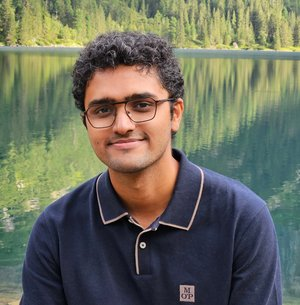

Hi there, I am a Ph.D. student under [Prof. Tobias Kramer](https://quantumobserver.wordpress.com/) at the [Institute for Theoretical Physics](https://www.jku.at/en/institute-for-theoretical-physics/), Linz. My papers are listed under [Works](/works/).

- [Email](mailto:akhil.bhartiya@jku.at)
- [LinkedIn](https://www.linkedin.com/in/bhartiya)
- [GitHub](https://github.com/akhilbhartiya)
- [ORCiD](https://orcid.org/0000-0001-8734-1606)
- [Google Scholar](https://scholar.google.com/citations?user=ZS47oC0AAAAJ&hl=en)

## Posts

* **[{{ post.title }}]({{ post.url }})** — *{{ post.date | date: "%B %d, %Y" }}*

